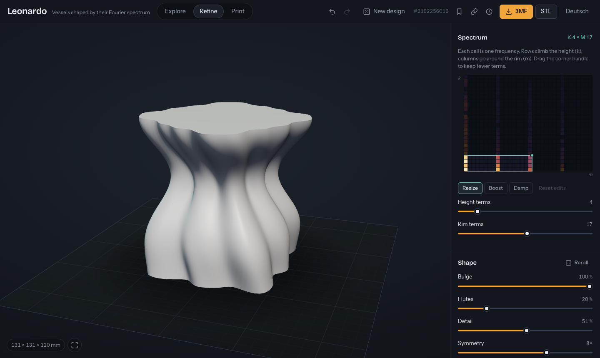

# Leonardo

Leonardo designs printable vessels from their Fourier spectrum. The shape is a radius
field `r(h, φ)`. A cosine series runs up the height and a Fourier series goes around the
rim. Every design is a small grid of coefficients, and summing them back gives the
surface. The background is in [docs/fourier-reconstruction.md](docs/fourier-reconstruction.md).

The app runs fully in the browser and needs no server. It exports watertight,
millimetre-scaled STL and 3MF files, ready for Bambu Studio or any other slicer.

**Live:** https://leonardo-design.netlify.app



## Workflow

1. **Explore** shows nine random vessels. Pick one, then press **Variations** for
   nine designs near it. **Variation strength** sets how far they stray. Press Space
   to shuffle.
2. **Refine** has these controls:
   - **Spectrum editor**: a heatmap of the coefficient grid. Rows are height
     frequencies (k), columns are rim frequencies (m).
     - Drag the corner to keep fewer terms (K × M truncation).
     - Use **Boost** or **Damp** to paint gains onto single frequencies.
   - **Shape**: bulge, flutes, detail, symmetry and ribs.
   - **Modifiers**: twist and corners.
3. **Print**:
   - Pick your printer and the object height. The preview shows the bed to scale.
   - Choose a body type:
     - **Solid**: closed; the slicer adds walls and infill.
     - **Vase mode**: closed, for spiral vase printing.
     - **Hollow**: real walls and floor.
     - **Planter**: hollow, with a drainage hole.
   - Read the estimates: size, volume, PLA grams and overhang area. **Show overhangs**
     paints faces that lean more than 45°.
4. **3MF** and **STL** download the export-resolution mesh. It is built in a Web
   Worker.

### Saving and sharing

- The address bar always holds the current design. A reload or a copied link
  reproduces it exactly.
- **Save**, exports and shared links add the design to **History**, which is
  stored in IndexedDB. History supports favourites.

### Keyboard and language

| Key | Action |
|---|---|
| `1` / `2` / `3` | Switch mode |
| Space | Shuffle (Explore) |
| ⌘/Ctrl Z, ⇧⌘/Ctrl Z | Undo, redo |
| ⌘/Ctrl S | Save |

The interface is available in English and German.

## Printing on a Bambu Lab printer

- Open the `.3mf` in Bambu Studio.
- The object stands on the bed in millimetres and fits the printer you chose, with
  10 mm free on each side.
- Every mesh is closed and consistently oriented, so no repair step is needed.
- For **Vase mode** designs, turn on *Others › Spiral vase* in the slicer.

## Development

You need Node 22 or newer.

```bash
npm install
npm run dev        # http://localhost:5173
npm test           # unit, property and component tests (Vitest)
npm run e2e        # Playwright: full flow on desktop and a phone
npm run build      # typecheck + production build into dist/
```

| Path | Contents |
|---|---|
| `src/engine/` | Pure TypeScript geometry: seeded PRNG, spectrum, radius field, bodies, validation, stats, STL/3MF |
| `src/design/` | Design schema, URL codec, random designs and variations |
| `src/state/`, `src/storage/` | zustand store with undo; IndexedDB history |
| `src/ui/` | React components, three.js viewport, theme |
| `src/worker/` | Export worker |

A property test builds 100 random designs in all four body types. Each must be a
closed, outward-oriented mesh with positive volume that fits the printer.

## Deploy

Netlify builds `npm run build` and publishes `dist/` (see `netlify.toml`).

## License

GPL-3.0-only.
